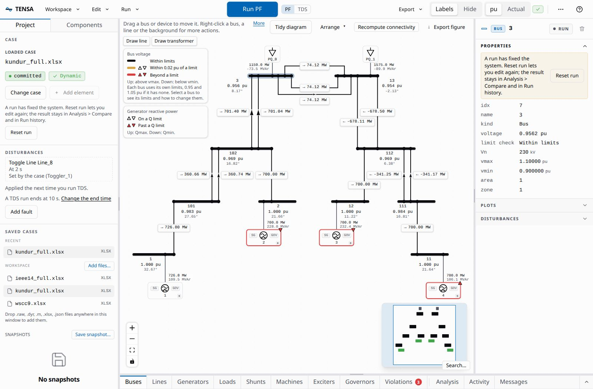

# TENSA

[](https://pypi.org/project/tensa/)
[](https://github.com/Roger-GO/TENSA/actions/workflows/server.yml)
[](https://github.com/Roger-GO/TENSA/actions/workflows/web.yml)
[](https://github.com/Roger-GO/TENSA/actions/workflows/docs.yml)
[](https://roger-go.github.io/TENSA/)
[](./LICENSE)
[](https://www.python.org/)
[](https://github.com/CURENT/andes)
[](./llms.txt)

TENSA is a power system workbench that runs in your browser. You draw a network or open a case file and run studies on its one-line diagram, and anything you do there can also be scripted through the API. The computation is done by [ANDES](https://github.com/CURENT/andes), or by NREL's Sienna packages if you install the second engine.



## What it does

It's meant for teaching, for exploratory dynamic studies where seeing the system matters, and for people who drive power system tools from scripts or LLM agents. For large batch runs or for writing new models, use ANDES directly.

- Power flow: steady-state voltages, angles and line flows, with the limits the solution breaks.
- Time-domain simulation: the system's response to a fault or line trip, plotted as it computes.
- Eigenvalue analysis: small-signal modes at the operating point, with frequency and damping.
- Continuation power flow: PV and QV curves up to the point where the power flow stops converging.
- State estimation: bus voltages estimated from measurements TENSA can generate from a solved power flow.

## Quick start

You need Python 3.12 or newer:

```bash
pip install tensa
tensa serve --open
```

The server starts on a free port and opens your browser. A new workspace gets five example cases: IEEE 14, Kundur, WSCC 9-bus, IEEE 39 and NPCC 140-bus. More are available from the app or with `tensa examples add <id>`. The [quick start](https://roger-go.github.io/TENSA/quickstart/) walks through a first study. Your own cases load as `.xlsx`, `.raw` with `.dyr`, `.m` or `.json`.

For a window of its own instead of a browser tab:

```bash
pip install "tensa[desktop]"
tensa desktop
```

On Linux: `pip install "tensa[desktop]" "pywebview[qt]"`.

It runs on Linux, macOS (Apple silicon) and Windows with Python 3.12 or 3.13. Windows on ARM is not supported: two dependencies publish no wheels for it.

## Demo

The GIF is a scripted walkthrough of the real UI, sped up: it builds WSCC 9-bus from scratch, saves and reloads the case, and runs every analysis. The script calls no model; it clicks and drags at positions written in the file.

[](https://github.com/Roger-GO/TENSA/raw/main/docs/demo/ieee9-agent-demo.mp4)

[Full 2-minute MP4](https://github.com/Roger-GO/TENSA/raw/main/docs/demo/ieee9-agent-demo.mp4). The driver script is [`web/scripts/agent-demo.mjs`](web/scripts/agent-demo.mjs). To record it yourself from a source checkout:

```bash
# Terminal 1: serve on a fixed port
tensa serve --port 18800

# Terminal 2: record (writes demo-video/ieee9-agent-demo.webm)
cd web
pnpm exec playwright install chromium
node scripts/agent-demo.mjs http://127.0.0.1:18800
```

## Engines

The default engine is ANDES. The optional `sienna` extra runs NREL's Sienna packages through Julia 1.13:

```bash
pip install "tensa[sienna]"
tensa warm-cache --engine sienna
```

Sienna adds network matrices, DC power flow, economic dispatch, unit commitment, and a day-ahead plus real-time simulation. A session runs one engine; run the same study in two sessions to compare results. [Engines](https://roger-go.github.io/TENSA/engines/) has the details.

## Scripts and agents

The UI talks to the server over a documented HTTP and WebSocket API. Scripts and LLM agents can use it too: see the [API guide](https://roger-go.github.io/TENSA/api/), the schema at `GET /openapi.json`, [llms.txt](./llms.txt), and worked examples in [examples/](./examples/). One of them, [`examples/contingency_screening/`](./examples/contingency_screening/), has scripted and LLM agents screen N-2 contingencies on IEEE 39 through the API; it needs `httpx`. There is an MCP server for assistants that speak Model Context Protocol ([setup](https://roger-go.github.io/TENSA/agents/)):

```bash
pip install "tensa[mcp]"
tensa mcp --workspace ~/tensa-cases
```

## Security

There is no authentication. The server listens on loopback only and trusts whoever is logged in to the machine. Case files can contain code that runs when they load, so treat them like scripts. Only use `--bind` on a network you trust. [SECURITY.md](./SECURITY.md) has the details.

## Getting help

One maintainer; replies are best effort. [SUPPORT.md](./SUPPORT.md) says which versions are supported.

- Questions: [GitHub Discussions Q&A](https://github.com/Roger-GO/TENSA/discussions/categories/q-a).
- Bugs and feature requests: [open an issue](https://github.com/Roger-GO/TENSA/issues/new/choose).
- Security problems: report privately via [private vulnerability reporting](https://github.com/Roger-GO/TENSA/security/advisories/new), per [SECURITY.md](./SECURITY.md).
- Anything else: the [documentation](https://roger-go.github.io/TENSA/).

Conduct: [CODE_OF_CONDUCT.md](./CODE_OF_CONDUCT.md).

## Citation

If you use TENSA in your work, please cite it. GitHub's "Cite this repository" button reads [CITATION.cff](./CITATION.cff). Short form:

> Gracia Otalvaro, R. (2026). TENSA: an interactive web workbench for power system simulation. https://github.com/Roger-GO/TENSA

The underlying computation is ANDES. Please credit the [CURENT/ANDES](https://github.com/CURENT/andes) project by Cui et al. as well.

## Contributing

PRs welcome. [CONTRIBUTING.md](./CONTRIBUTING.md) covers setup and tests, [AGENTS.md](./AGENTS.md) has notes for AI coding agents, the [changelog](./CHANGELOG.md) lists what changed. For anything bigger than a small fix, open an issue first.

## License

[GPL-3.0-or-later](./LICENSE), the same license as ANDES. The web UI bundles third-party libraries under their own licenses, listed in `THIRD-PARTY-LICENSES.txt` beside each build.
